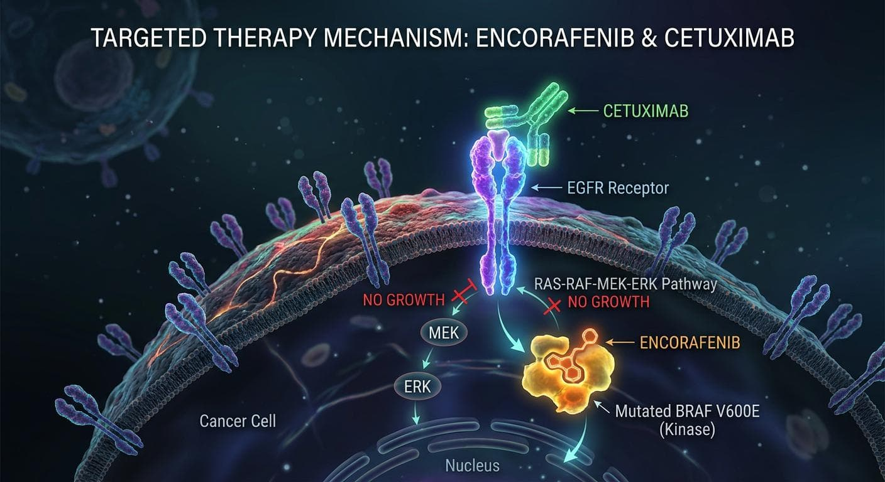

When people think of [colorectal cancer](https://dengyuerx.com/product-category/prescription-medicines/gastroenterology/), they often think first of surgery, chemotherapy, and conventional drug treatments. However, as medical research continues to advance, doctors can now analyze the genetic characteristics of tumors to identify more targeted treatment options for patients.

One important biomarker is the BRAF V600E mutation. For patients with BRAF V600E-mutated metastatic colorectal cancer, the combination of encorafenib and cetuximab offers an important targeted treatment option.

What exactly is the BRAF V600E mutation? Why are these two medicines used together? And what changes have they brought to colorectal cancer treatment?

## I. What Is the BRAF V600E Mutation, and Why Does It Matter?

Our bodies rely on complex signaling systems to regulate cell growth and division. The BRAF gene plays a role in one of these important regulatory processes.

When the BRAF gene develops the V600E mutation, the associated signaling pathway may remain abnormally active, causing cells to receive continuous growth signals. In some cases, this change can contribute to tumor development.

For patients with colorectal cancer, the BRAF V600E mutation has important clinical implications. Tumors carrying this mutation often have distinct biological characteristics and may present different treatment challenges.

However, identifying a genetic mutation does not mean that the disease cannot be treated. On the contrary, understanding a tumor's genetic profile can help doctors determine which treatment options may be appropriate for an individual patient.

This is a key principle of precision medicine: rather than focusing only on where a tumor develops, doctors also examine its molecular characteristics to guide treatment decisions.

## II. Encorafenib and Cetuximab: Why Are They Used in Combination?

In the treatment of BRAF V600E-mutated colorectal cancer, encorafenib and cetuximab are two medicines that have attracted considerable attention.

Encorafenib is a targeted medicine that inhibits abnormal signaling associated with the BRAF V600E mutation, helping reduce signals that promote tumor growth.

Cetuximab is a monoclonal antibody that blocks signaling associated with the epidermal growth factor receptor (EGFR) on the surface of cells. In simple terms, it targets another signaling pathway that may help cancer cells continue to grow.

Why not use just one of these medicines?

Tumor cells can adapt to changes in their environment. When one growth-signaling pathway is inhibited, other pathways may sometimes become active again. In some colorectal cancers, inhibiting BRAF alone is not sufficient to fully control the associated signaling activity.

By targeting both BRAF and EGFR, the combination interferes with tumor-related signaling at different points. This approach also illustrates a central principle of precision treatment: selecting medicines according to a tumor's specific molecular characteristics rather than applying exactly the same treatment to every patient.

Of course, combination treatment is not suitable for every patient with colorectal cancer. Treatment decisions must take into account genetic test results, disease stage, and previous treatments, among other factors.

## III. What Advances Have Clinical Studies Demonstrated?

The therapeutic value of combining [encorafenib](https://dengyuemed.com/product/encorafenib-non-small-cell-lung-cancer/) and [cetuximab](https://dengyuemed.com/product/enlitux-cetuximab-beta-injection-crc/) has been evaluated in several clinical studies.

The BEACON CRC trial focused on patients with BRAF V600E-mutated metastatic colorectal cancer whose disease had progressed after previous treatment. The results supported the use of this combination, providing an additional treatment option for eligible patients.

Subsequently, the BREAKWATER trial further investigated this treatment approach in the first-line setting.

The study evaluated encorafenib and cetuximab in combination with mFOLFOX6 chemotherapy. According to the reported Phase III results, median progression-free survival was 12.8 months in the combination-treatment group, compared with 7.1 months in the control group. Median overall survival was 30.3 months and 15.1 months, respectively.

These findings suggest that, among eligible patients in the study, the combination demonstrated encouraging results in delaying disease progression and improving survival outcomes.

In February 2026, the U.S. Food and Drug Administration (FDA) granted approval for encorafenib in combination with cetuximab and fluorouracil-based chemotherapy for eligible adult patients with BRAF V600E-mutated metastatic colorectal cancer.

This development highlights an important point: precision treatment is not simply about identifying a medicine that targets a particular genetic mutation. It also involves continuously investigating how different treatment approaches can be combined to achieve better clinical outcomes.

It is important to note that treatment regimens may differ depending on the stage of treatment, and approved indications may vary between countries and regions. The clinical results described above cannot directly predict the outcome for any individual patient.

## IV. How Can Genetic Testing Help Guide Treatment Decisions?

For patients with colorectal cancer, genetic testing can provide information that conventional examinations may not directly reveal.

By examining a tumor's molecular characteristics, doctors can determine whether a patient carries specific alterations, such as the BRAF V600E mutation. Combined with other relevant biomarkers and clinical information, these results can help inform potential treatment strategies.

However, genetic testing is only one part of treatment planning. Disease progression, the patient's general health, previous treatment history, and tolerance of medicines can also influence the final decision.

If testing identifies a BRAF V600E mutation, patients can discuss the significance of the result with their oncology team and ask whether targeted treatment options may be appropriate for their individual circumstances. Patients should not purchase or use medicines on their own based solely on genetic test results.

## V. From Innovative Medicine Information to Compliant Supply Chain Services

As precision medicine advances, an increasing number of specialized medicines are entering clinical practice. For healthcare institutions, professional procurement partners, and companies involved in international pharmaceutical supply chains, understanding a medicine's indications, regulatory status, and supply requirements has become increasingly important.

[DengYueRX](https://dengyuerx.com/) follows pharmaceutical developments across different therapeutic areas and provides pharmaceutical sourcing coordination, supply-chain connections, and cross-border pharmaceutical supply-chain services. These services help eligible procurement partners understand relevant medicine supply arrangements and procurement processes.

For specialized medicines such as encorafenib and cetuximab, actual supply arrangements must be verified according to the registration requirements of the destination market, product availability, and applicable import and export regulations. Whether a medicine can be supplied or imported, and the conditions under which it may be used legally, must be assessed in accordance with the relevant laws and regulatory requirements.

## Conclusion

Progress in understanding the BRAF V600E mutation and the use of encorafenib combined with cetuximab demonstrates the important role of precision medicine in colorectal cancer treatment. By understanding a tumor's genetic characteristics, doctors can evaluate treatment options more specifically, while accumulating clinical evidence continues to support the development of treatment strategies.

For patients and those interested in medical and pharmaceutical developments, learning about new treatment advances, understanding the role of genetic testing, and making treatment decisions under the guidance of qualified healthcare professionals are important steps toward a better understanding of precision medicine.
