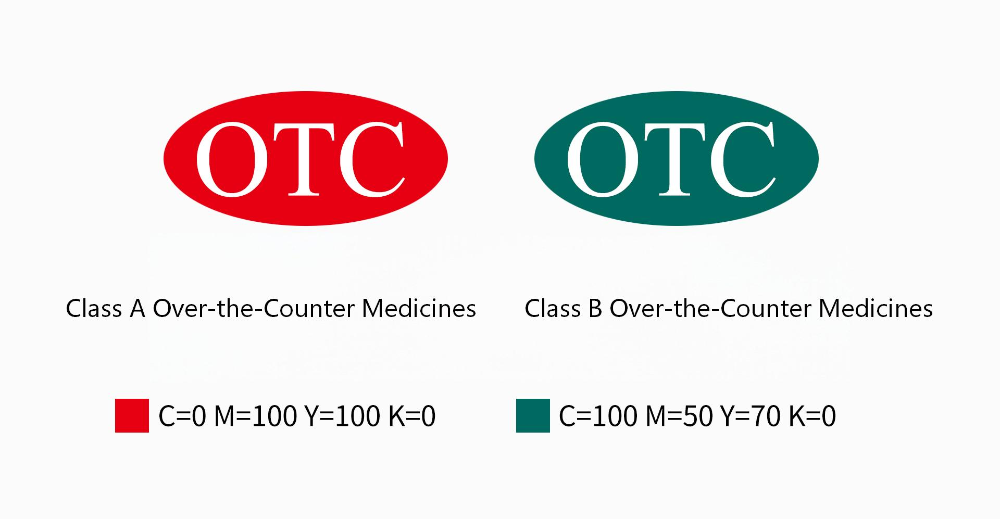
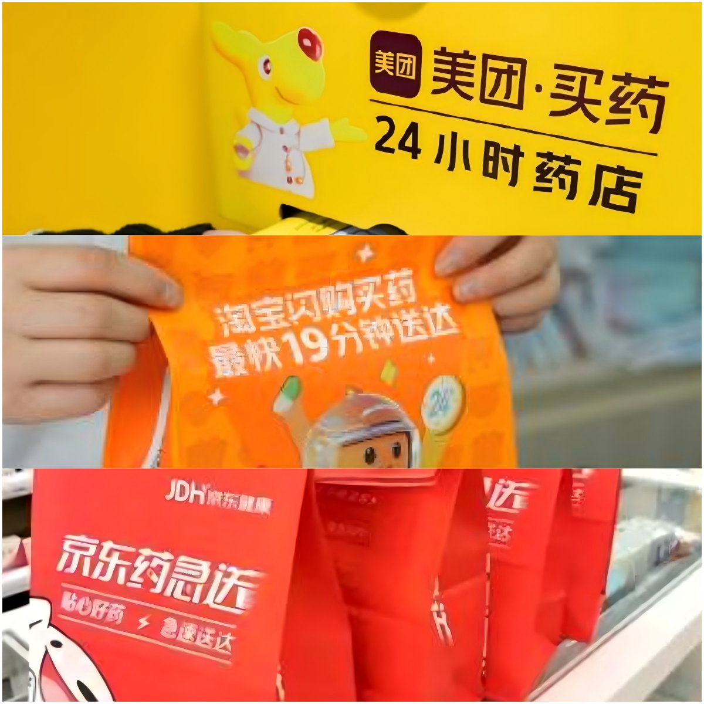

Medicines in China are divided into two categories: [prescription medicines](https://dengyuerx.com/product-category/prescription-medicines/), which require a doctor's prescription, and [over-the-counter (OTC) medicines](https://dengyuerx.com/product-category/otc-pharmacy/), which can be purchased without one.

There are three common ways to obtain medicines in China:
- **Physical pharmacies:** Offer medicines for colds, pain relief, stomach problems, and minor injuries.
- **Online medicine ordering:** Platforms such as Meituan and Taobao Flash Sale provide online medicine delivery, with delivery times typically ranging from 30 to 60 minutes in some urban areas.
- **Hospital visits:** If you need a medical diagnosis or a prescription, you can visit a hospital and collect your medicines from its pharmacy.

This article covers these three practical scenarios and provides commonly used Chinese vocabulary, Pinyin, and English translations to help foreigners purchase medicines more easily in China.

## Core Chinese Vocabulary

| 中文 | 拼音 | English |
|---|---|---|
| 药店 / 药房 | yàodiàn / yàofáng | Pharmacy |
| 处方药 | chǔfāngyào | Prescription medicine |
| 非处方药 | fēi chǔfāngyào | Over-the-counter (OTC) medicine |
| 处方 | chǔfāng | Prescription |
| 药师 | yàoshī | Pharmacist |
| 通用名 | tōngyòngmíng | Generic name |
| 规格 | guīgé | Strength |
| 用法用量 | yòngfǎ yòngliàng | Dosage |
| 饭前 / 饭后 | fànqián / fànhòu | Before / after meals |
| 一次几片 | yí cì jǐ piàn | How many tablets per dose |
| 有效期 | yǒuxiàoqī | Expiry date |
| 过敏 | guòmǐn | Allergy |
| 发烧 | fāshāo | Fever |
| 感冒 | gǎnmào | Cold |
| 咳嗽 | késou | Cough |
| 拉肚子 | lā dùzi | Diarrhoea |
| 抗生素 | kàngshēngsù | Antibiotics |
| 布洛芬 | bùluòfēn | Ibuprofen |
| 对乙酰氨基酚 | duìyǐxiān'ānjīfēn | Paracetamol |
| 蒙脱石散 | méngtuōshísǎn | Diosmectite |
| 创可贴 | chuàngkětiē | Adhesive plaster / Band-Aid |
| 发票 | fāpiào | Invoice |

Red-labeled OTC medicines are Class A OTC medicines. They are generally sold only in pharmacies staffed by licensed pharmacists.

Green-labeled OTC medicines are Class B OTC medicines. They can be sold in pharmacies and other approved retail outlets.

When purchasing medicines, it is generally more helpful to use the generic name rather than an overseas brand name. For example, international brands such as Advil, Tylenol, and Claritin may not have a directly recognizable equivalent at Chinese pharmacy counters. Providing the generic name or active ingredient can make it easier for pharmacists to identify the corresponding medicine:
- Advil → Ibuprofen (布洛芬)
- Tylenol → Paracetamol / Acetaminophen (对乙酰氨基酚)
- Claritin → Loratadine (氯雷他定)

## Scenario 1: Buying Medicine at a Physical Pharmacy

Chinese retail pharmacies usually have a green cross sign and storefront signage featuring terms such as "药房" or "大药房".

Common pharmacy chains include LBX Pharmacy, GuoDa Pharmacy, and [DengYue Pharmacy](https://dengyuerx.com/). Pharmacies generally have licensed pharmacists available to provide consultation, and medicine prices are usually displayed clearly.

**Common Pharmacy Signage**

| Chinese | Pinyin | Meaning |
|---|---|---|
| 药店 / 药房 | yàodiàn / yàofáng | Pharmacy |
| 大药房 | dà yàofáng | Large / chain pharmacy |
| 24 小时药店 | èrshísì xiǎoshí yàodiàn | 24-hour pharmacy |
| 医保定点 | yībǎo dìngdiǎn | Designated provider for China's medical insurance |
| 中药房 | zhōngyàofáng | Traditional Chinese medicine pharmacy |

Once inside, you can simply show the pharmacist your phone screen with the Chinese medicine name or a description of your symptoms.

Before purchasing, check the medicine's ingredients, strength, and quantity. Payment can usually be made through Alipay, WeChat Pay, or cash.

**Useful Chinese Phrases at a Pharmacy**

| Chinese | Pinyin | English |
|---|---|---|
| 你好，我要买感冒药。 | Nǐ hǎo, wǒ yào mǎi gǎnmào yào. | Hello, I'd like to buy some cold medicine. |
| 我发烧了，需要退烧药。 | Wǒ fāshāo le, xūyào tuìshāo yào. | I have a fever. I need a fever reducer. |
| 我头疼，需要止痛药。 | Wǒ tóuténg, xūyào zhǐtòng yào. | I have a headache. I need a painkiller. |
| 我嗓子疼，有没有含片？ | Wǒ sǎngzi téng, yǒu méi yǒu hánpiàn? | My throat hurts. Do you have any lozenges? |
| 我拉肚子，需要止泻药。 | Wǒ lā dùzi, xūyào zhǐxiè yào. | I have diarrhea. I need an anti-diarrheal medicine. |
| 我过敏了，身上痒。 | Wǒ guòmǐn le, shēnshang yǎng. | I'm having an allergic reaction, and my skin feels itchy. |
| 我对青霉素过敏。 | Wǒ duì qīngméisù guòmǐn. | I'm allergic to penicillin. |
| 这个是非处方药吗？ | Zhège shì fēi chǔfāngyào ma? | Is this an OTC medicine? |
| 一天吃几次？一次吃几片？ | Yì tiān chī jǐ cì? Yí cì chī jǐ piàn? | How many times a day should I take it? How many tablets each time? |
| 饭前还是饭后？ | Fànqián háishì fànhòu? | Should I take it before or after meals? |
| 有儿童用的吗？ | Yǒu értóng yòng de ma? | Do you have a version for children? |
| 请给我开发票。 | Qǐng gěi wǒ kāi fāpiào. | Please issue an invoice for me. |

**Two Important Reminders**
- Some compound cold medicines containing ephedrine require real-name registration and are subject to purchase limits. You may be asked to present your original passport when purchasing them.
- Antibiotics are prescription medicines and generally cannot be purchased directly over the counter. A prescription from a licensed physician in China is required.

## Scenario 2: Ordering Medicine Online

In China, common OTC medicines can often be ordered online and delivered by local pharmacies.

Popular platforms include Meituan Medicine, Taobao Flash Delivery, and JD Health.

Most platform interfaces are in Chinese, so you can enter the following words and phrases directly into the search bar. Placing an order generally requires a mainland Chinese mobile phone number, a complete Chinese delivery address, and an available payment account.

**Useful Chinese Search Terms and Delivery Phrases**

| Chinese (Search Terms / Notes) | Pinyin | English |
|---|---|---|
| 感冒药 | gǎnmào yào | Cold medicine |
| 退烧药 | tuìshāo yào | Fever reducer |
| 布洛芬 | bùluòfēn | Ibuprofen |
| 止泻药 | zhǐxiè yào | Anti-diarrheal medicine |
| 过敏药 | guòmǐn yào | Allergy medicine |
| 24 小时药店 | èrshísì xiǎoshí yàodiàn | 24-hour pharmacy |
| 送到酒店前台 | sòng dào jiǔdiàn qiántái | Please deliver it to the hotel front desk. |
| 放前台就好 | fàng qiántái jiù hǎo | Just leave it at the front desk. |
| 多久能送到？ | duōjiǔ néng sòng dào? | How long will delivery take? |
| 有货吗？ | yǒu huò ma? | Is it in stock? |
| 需要发票 | xūyào fāpiào | I need an invoice. |

**Three Important Rules for Online Medicine Orders**

1. **Prescription medicines:** Eligible patients receiving follow-up care may obtain electronic prescriptions through online medical consultation services. Patients seeking an initial diagnosis, requiring further examinations, or whose conditions are unsuitable for online consultation should visit a medical institution in person.
2. **Medicines prohibited from online retail:** Certain categories of medicines are prohibited from online retail in China. These include compound preparations containing ephedrine, single-ingredient oral pregabalin preparations, and certain compound dextromethorphan and guaifenesin preparations.
3. **Checking delivered medicines:** After receiving your order, check the medicine name, strength, packaging, and expiry date to ensure they match the order. If you notice anything unusual, contact the platform's customer service promptly.

## Scenario 3: Visiting a Hospital

Foreign visitors can generally use their passports to register at hospitals in China.

Some public hospitals in major cities have international medical departments that provide services in both Chinese and English. Regular outpatient departments, however, generally operate primarily in Chinese.

After examining you, the doctor may issue a prescription in accordance with Chinese regulations if necessary. You can then collect the prescribed medicines from the hospital pharmacy. Prescriptions issued overseas are not automatically valid for dispensing at retail pharmacies in China.

If you take long-term medication, it is advisable to bring the original medicine packaging, previous prescriptions, and a list of your current medicines to help the doctor assess your condition.

**Useful Chinese Phrases at a Hospital**

| Chinese | Pinyin | English |
|---|---|---|
| 我要挂号。 | Wǒ yào guàhào. | I would like to register. |
| 可以用护照挂号吗？ | Kěyǐ yòng hùzhào guàhào ma? | Can I register using my passport? |
| 国际医疗部在哪里？ | Guójì yīliáo bù zài nǎlǐ? | Where is the International Medical Department? |
| 我看内科。 | Wǒ kàn nèikē. | I'd like to see an internal medicine doctor. |
| 我发烧三天了。 | Wǒ fāshāo sān tiān le. | I have had a fever for three days. |
| 我一直在吃这个药。 | Wǒ yìzhí zài chī zhège yào. | I have been taking this medicine. |
| 这是我的药盒。 | Zhè shì wǒ de yàohé. | This is my medicine box. |
| 我需要开处方。 | Wǒ xūyào kāi chǔfāng. | I need a prescription. |
| 需要化验吗？ | Xūyào huàyàn ma? | Do I need any tests? |
| 到哪里取药？ | Dào nǎlǐ qǔ yào? | Where can I collect my medicine? |
| 取药窗口在几楼？ | Qǔyào chuāngkǒu zài jǐ lóu? | Which floor is the pharmacy counter on? |
| 挂号费多少钱？ | Guàhào fèi duōshao qián? | How much is the registration fee? |
| 急诊在哪里？ | Jízhěn zài nǎlǐ? | Where is the emergency department? |
| 请给我收据。 | Qǐng gěi wǒ shōujù. | Please give me a receipt. |

**Two Important Reminders**
- Registration fees, examination fees, and medication costs generally need to be paid out of pocket.
- If you experience a persistent high fever, chest pain, difficulty breathing, or confusion, seek emergency medical attention promptly. The emergency ambulance number in mainland China is 120.
