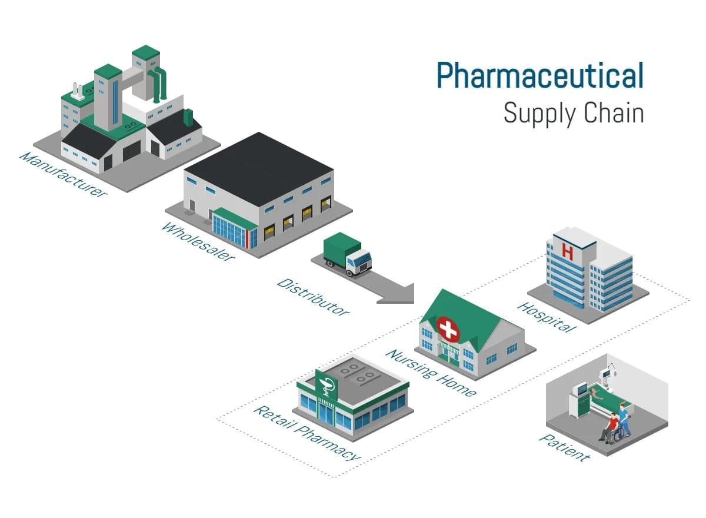
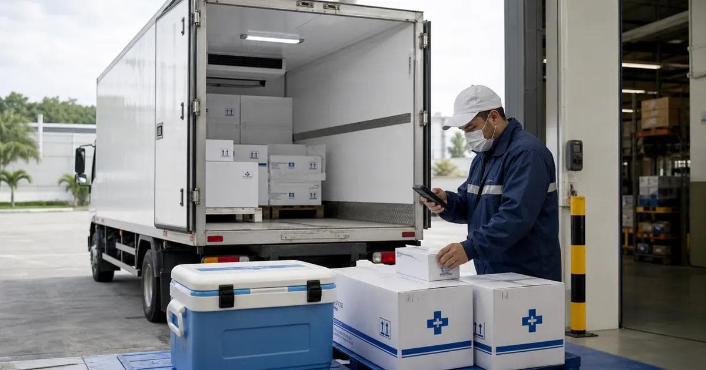
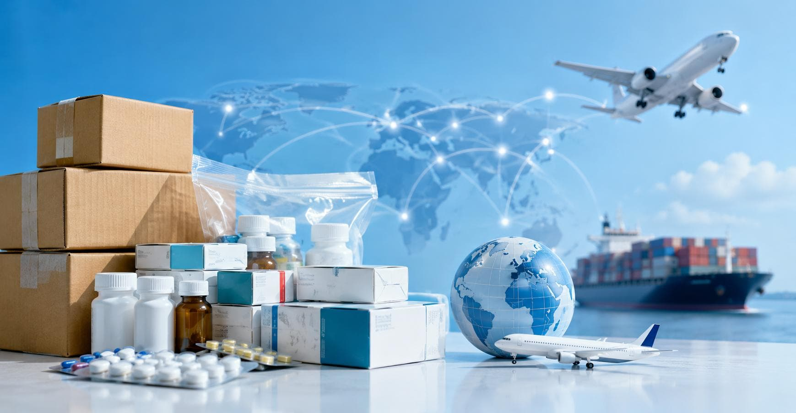

After medicines leave the manufacturing stage and enter the market, they do not reach all end users directly. Instead, they pass through multiple stages, including procurement, warehousing, quality management, distribution and transportation. Throughout this process, Marketing Authorization Holders (MAHs), pharmaceutical manufacturers, wholesalers, pharmaceutical logistics providers, hospitals and retail pharmacies work together to form China's pharmaceutical wholesale and distribution system.

This system not only connects pharmaceutical suppliers with buyers but also plays an important role in distribution efficiency, supply stability and quality management. As China's pharmaceutical market and international pharmaceutical trade continue to develop, understanding the structure, operational processes and regulatory requirements of China's pharmaceutical wholesale and distribution system is practically important for domestic and international pharmaceutical buyers, hospitals, pharmacies and pharmaceutical distributors.

## What Is Pharmaceutical Wholesale and Distribution in China?

China's pharmaceutical wholesale and distribution system refers to the network through which medicines are procured from upstream suppliers, stored, processed, transported and delivered to hospitals, pharmacies and other qualified buyers. Pharmaceutical wholesalers play an important role in connecting upstream medicine suppliers with downstream buyers.

Although pharmaceutical wholesale and retail are both pharmaceutical business activities, they differ in their customer groups and business models. Wholesale primarily serves hospitals, pharmacies and other qualified organizations, focusing on bulk medicine procurement and supply. Retail, on the other hand, mainly serves patients and consumers through direct medicine sales.

| Comparison | Pharmaceutical Wholesale | Pharmaceutical Retail |
|---|---|---|
| Main Customers | Hospitals, pharmacies and other qualified buyers | Patients and consumers |
| Business Model | Bulk procurement and supply | Direct sales to consumers |
| Main Activities | Medicine procurement, warehousing and distribution | Medicine sales and related pharmacy services |

Therefore, pharmaceutical wholesale involves more than simply reselling products. It also includes supplier qualification checks, inventory management, quality control and delivery coordination. To understand how these activities are connected, it is also necessary to examine the key participants in the pharmaceutical distribution system.

## Key Participants in China's Pharmaceutical Distribution System

China's pharmaceutical distribution system is not operated by a single type of business. Instead, it relies on the collaboration of multiple participants. Each plays a different role in medicine supply, business operations, storage, transportation or end-user access, forming an interconnected supply chain.

- **Marketing Authorization Holders (MAHs):** Hold the marketing authorization for medicines and assume relevant responsibilities for product quality and post-market management in accordance with applicable regulations.
- **Pharmaceutical Manufacturers:** Manufacture medicines in accordance with approved production processes and quality standards, providing products for the distribution system.
- **Pharmaceutical Wholesalers:** Procure medicines from qualified suppliers and supply them to hospitals, pharmacies and other eligible buyers.
- **Pharmaceutical Logistics Providers:** Provide specialized warehousing, transportation and delivery services, supporting the movement of medicines across different regions.
- **Hospitals and Retail Pharmacies:** Act as downstream buyers, purchasing medicines for clinical use or for supply to patients and consumers.

The business relationships among these participants are not always fixed. For example, medicines may be supplied directly by MAHs or manufacturers to eligible buyers, or they may pass through pharmaceutical wholesalers and regional distribution channels. The specific arrangement generally depends on the product category, supply structure and procurement requirements.

Once the responsibilities of these participants are understood, it becomes easier to follow how medicines move from procurement to final delivery.

## How Does Pharmaceutical Wholesale and Distribution Work in China?

Pharmaceutical wholesale and distribution generally involve several stages, including procurement, receiving and inspection, warehousing, order processing, transportation and delivery. These stages must be properly coordinated and comply with the relevant pharmaceutical quality management requirements.

**1. Pharmaceutical Procurement**

Wholesalers select qualified suppliers based on customer demand, inventory levels and market supply conditions. They then determine the products to be purchased, including medicine names, strengths, dosage forms, packaging and quantities. Supplier qualifications and relevant product information must also be verified during procurement to ensure that medicines come from legitimate sources.

**2. Quality Inspection and Warehousing**

Upon arrival, medicines undergo receiving and inspection procedures in accordance with applicable requirements. Information such as product names, batch numbers, quantities, packaging and expiry dates must be checked. After passing inspection, medicines are stored under the specified conditions to prevent environmental factors, such as temperature and humidity, from affecting product quality.

**3. Inventory Management**

After medicines are received into storage, wholesalers need to continuously manage stock levels, product batches and expiry dates to maintain a stable supply and reduce inventory risks. For medicines requiring refrigeration or other special storage conditions, appropriate environmental monitoring and management measures must be implemented.

**4. Order Processing and Distribution**

When hospitals, pharmacies or other qualified buyers place orders, wholesalers verify customer qualifications, confirm product availability and arrange order fulfillment. Depending on the supply arrangement, medicines may be delivered directly to downstream buyers or further distributed through qualified regional wholesalers.

**5. Transportation and Delivery**

After order processing, medicines must be transported using appropriate methods based on their characteristics and specified storage requirements. These may include road transportation, specialized pharmaceutical logistics and temperature-controlled cold-chain delivery. Air transportation may also be used where appropriate. For temperature-sensitive medicines, temperature monitoring and relevant transportation records must be maintained throughout the process.

**6. Delivery and Traceability**

After medicines are delivered, relevant transaction and distribution records must be retained in accordance with applicable requirements. Batch information, supplier details and product distribution records help support pharmaceutical traceability, quality investigations and product recalls.

From procurement to final delivery, these stages form the basic operational process of pharmaceutical wholesale and distribution. However, in actual business operations, the relationships between companies and the routes through which medicines circulate may vary, resulting in several different distribution models.

## Major Pharmaceutical Distribution Models in China

Depending on medicine categories, procurement needs and supply arrangements, China's pharmaceutical distribution system mainly operates through direct supply, wholesale distribution, regional distribution, and centralized procurement and delivery models.

**1. Direct Supply Model**

MAHs or pharmaceutical manufacturers may supply medicines directly to qualified buyers when permitted by applicable regulations. In suitable circumstances, this model can reduce intermediate distribution steps and establish a direct connection between upstream suppliers and buyers.

**2. Wholesale Distribution Model**

Pharmaceutical wholesalers procure medicines from upstream suppliers and then supply them to hospitals, pharmacies or other eligible businesses. This is an important business model within the pharmaceutical wholesale system and helps connect different types of downstream buyers.

**3. Regional Distribution Model**

Under regional distribution arrangements, upstream suppliers cooperate with regional wholesalers that hold the necessary qualifications. These wholesalers are responsible for medicine supply and delivery within designated regions. This model helps expand distribution coverage, although all distribution activities must comply with applicable business requirements.

**4. Centralized Procurement and Distribution Model**

Centralized procurement is an important mechanism within China's public medical institution procurement system. Medical institutions purchase medicines according to relevant procurement arrangements, while qualified distribution companies undertake the corresponding supply and delivery responsibilities.

✨ Different distribution models vary in terms of procurement channels, distribution levels and delivery arrangements. However, regardless of the model adopted, pharmaceutical business activities must comply with the relevant regulatory and quality management requirements. These requirements provide an important foundation for the standardized operation of China's pharmaceutical wholesale and distribution system.

## What Regulations and Quality Management Requirements Must Pharmaceutical Wholesalers Follow?

As medicines are directly related to public health, China exercises strict supervision over pharmaceutical wholesale activities. Businesses are required to implement appropriate quality management measures throughout procurement, storage, sales and transportation.

- **Drug Distribution License:** Businesses engaged in pharmaceutical wholesale must obtain the required drug distribution license in accordance with the law and operate within their approved business scope and authorized business model.
- **Good Supply Practice (GSP):** GSP establishes quality management requirements for pharmaceutical procurement, receiving and inspection, storage, sales and transportation. It serves as an important basis for the daily quality management activities of pharmaceutical businesses and helps ensure that medicines meet the relevant quality requirements throughout distribution.
- **Drug Traceability and Storage and Transportation Management:** Pharmaceutical businesses must retain purchasing, sales and inventory records in accordance with applicable requirements to ensure that medicine distribution information can be traced. Warehousing and transportation conditions must also meet the specific quality requirements of each medicine. For temperature-sensitive products, businesses need to pay particular attention to cold-chain facilities, temperature monitoring and transportation records.

Overall, pharmaceutical wholesale and distribution activities in China are primarily regulated by the Drug Administration Law of the People's Republic of China and relevant pharmaceutical business quality management regulations. Businesses may only conduct the corresponding pharmaceutical operations when they meet the applicable regulatory and quality requirements.

On this basis, China's pharmaceutical distribution system not only serves the domestic market but also provides channels for eligible international procurement and cross-border supply cooperation. For overseas organizations seeking to source medicines from China, understanding the domestic distribution system is only part of the process; they must also consider the compliance requirements involved in cross-border transactions.

## How to Source Medicines from China for International Markets?

China's pharmaceutical supply chain provides various sourcing opportunities for international buyers. Overseas pharmacies, hospitals, pharmaceutical wholesalers and other qualified organizations can identify suitable supply channels according to their actual needs.

However, cross-border pharmaceutical procurement differs from domestic distribution. In addition to product selection and supplier verification, buyers must also consider export requirements, import regulations in the destination country or region, and international transportation and customs clearance arrangements.

**1. Pharmaceutical Sourcing and Supplier Coordination**

International buyers can identify suitable Chinese pharmaceutical suppliers based on the required medicine categories, specifications, quantities and destination-market requirements. In Hong Kong's pharmaceutical import, export and wholesale supply chain, DengYueMed, for example, is a pharmaceutical wholesaler whose related business activities involve pharmaceutical sourcing and cross-border supply coordination, helping connect different procurement requirements with appropriate supply chain arrangements.

**2. Product Information Verification and Procurement**

Before placing an order, buyers should confirm essential product information, including:
- International Nonproprietary Name (INN) or brand name
- Dosage form, strength and packaging
- Manufacturer and product origin
- Required procurement quantities and product availability
- Applicable product registration and import requirements

In addition, buyers should verify supplier qualifications and review relevant quality documents and product information according to their procurement needs to determine whether the medicines meet the applicable purchasing and import requirements.

**3. Export Documentation and Regulatory Compliance**

Cross-border pharmaceutical transactions may involve commercial invoices, packing lists, certificates of origin where applicable, pharmaceutical quality documents and other regulatory documentation. Specific documentation requirements should be determined according to the medicine category, transaction arrangements and export destination.

Buyers must also confirm the destination country's or region's requirements concerning medicine registration, import licenses, labeling and authorized distribution. It is important to note that the availability of a medicine for procurement in China does not automatically mean that it can be imported or sold in another country or region.

**4. International Transportation and Medicine Delivery**

After procurement and export arrangements have been completed, medicines must be transported through suitable international logistics channels. Depending on product characteristics, transportation options may include air freight, road transportation or temperature-controlled cold-chain services.

Upon arrival at the destination, the importing entity must hold the appropriate qualifications and complete the applicable customs clearance, receiving and storage procedures. Medicines can then proceed to further distribution in accordance with local regulations.

Therefore, international pharmaceutical procurement requires not only reliable product sourcing channels but also effective coordination among suppliers, procurement partners, logistics providers and authorized importers in the destination market.

## Conclusion

China's pharmaceutical wholesale and distribution system consists of multiple participants, including MAHs, pharmaceutical manufacturers, wholesalers, logistics providers and downstream buyers. Its basic operations cover medicine procurement, quality inspection, warehousing, order processing, transportation, delivery and pharmaceutical traceability. Different distribution models provide various supply channels, while drug distribution licenses, GSP and other quality management requirements establish the regulatory framework for the entire distribution process.

For international pharmaceutical buyers, understanding China's pharmaceutical wholesale and distribution system not only helps them identify domestic medicine supply channels but also supports supplier evaluation, product document verification and cross-border procurement planning. As international pharmaceutical trade continues to develop, compliant procurement channels, reliable medicine sources, standardized quality management and effective logistics coordination will remain essential to establishing stable and sustainable pharmaceutical supply partnerships.
